# Buku Panduan Pengguna (User Manual Guide) — Uzma Course

Dokumen ini adalah ringkasan operasional **Uzma Course**. Rujukan utama pada versi aplikasi terkini adalah dua panduan web terpisah dengan langkah bergambar, aturan sistem, saran operasional, dan bantuan:

- **Admin:** [Panduan Admin](/admin/panduan), melalui menu **Bantuan → Panduan Pengguna**.
- **Guru:** [Panduan Guru](/guru/panduan), melalui **Profil → Panduan Pengguna**.

Keduanya memerlukan akun dengan peran yang sesuai. Tautan rute dibuka pada origin aplikasi yang menjalankan versi ini; panduan web bukan halaman publik tanpa login. **Cetak panduan** mencetak artikel yang sedang dipilih beserta screenshot, peringatan, dan jawaban bantuannya.

> **PDF arsip:** [`buku-panduan-pengguna.pdf`](buku-panduan-pengguna.pdf) adalah snapshot lama yang tidak diperbarui bersama panduan web ini. Gunakan panduan web sesuai peran untuk langkah dan label kontrol terkini.

---

## DAFTAR ISI
1. [Gambaran Umum Sistem & Hak Akses](#1-gambaran-umum-sistem--hak-akses)
2. [Panduan Operasional Portal Admin](#2-panduan-operasional-portal-admin)
   - [2.1 Login & Navigasi Utama](#21-login--navigasi-utama)
   - [2.2 Kelola Data Master](#22-kelola-data-master)
   - [2.3 Penyusunan Jadwal Kelas (Kanban Board)](#23-penyusunan-jadwal-kelas-kanban-board)
   - [2.4 Modul Penggajian Guru (Payroll)](#24-modul-penggajian-guru-payroll)
   - [2.5 Modul Tagihan SPP Murid & Kwitansi Resmi](#25-modul-tagihan-spp-murid--kwitansi-resmi)
   - [2.6 Pengelolaan Konten Website (Landing Page CMS)](#26-pengelolaan-konten-website-landing-page-cms)
3. [Panduan Operasional Portal Guru (PWA Mobile)](#3-panduan-operasional-portal-guru-pwa-mobile)
   - [3.1 Pemasangan Aplikasi PWA di Smartphone](#31-pemasangan-aplikasi-pwa-di-smartphone)
   - [3.2 Presensi Kehadiran Berbasis Geofence GPS](#32-presensi-kehadiran-berbasis-geofence-gps)
   - [3.3 Jadwal Mengajar Harian](#33-jadwal-mengajar-harian)
   - [3.4 Pengisian Kartu Kendali Mengajar (Teaching Log)](#34-pengisian-kartu-kendali-mengajar-teaching-log)
   - [3.5 Slip & Estimasi Honor Guru](#35-slip--estimasi-honor-guru)
4. [Tanya Jawab & Pemecahan Masalah (FAQ)](#4-tanya-jawab--pemecahan-masalah-faq)

---

## 1. Gambaran Umum Sistem & Hak Akses

Sistem Uzma Course membagi akses operasional menjadi dua antarmuka khusus:
- **Portal Admin (`/admin`)**: Dioptimalkan untuk perangkat layar lebar (Desktop/Laptop/Tablet) guna mengelola basis data terpusat, menyusun jadwal visual, mengawasi kas masuk SPP murid, dan memproses penggajian guru.
- **Portal Guru (`/guru`)**: Dirancang khusus untuk smartphone dengan teknologi *Progressive Web App* (PWA) yang ringan, cepat, dan mendukung sinkronisasi presensi saat koneksi seluler kurang stabil.

### Akun & Keamanan
- Halaman login tunggal: `https://uzmacourse.com/login` (atau `http://localhost:3000/login`).
- Sistem secara otomatis mengarahkan peran pengguna setelah login:
  - Akun **Admin** langsung diarahkan ke Dashboard `/admin`.
  - Akun **Guru** langsung diarahkan ke Beranda Guru `/guru`.

---

## 2. Panduan Operasional Portal Admin

### 2.1 Login & Navigasi Utama
1. Buka tautan login di browser.
2. Masukkan alamat email admin (misal: `admin@uzmacourse.com`) dan kata sandi.
3. Klik **"Masuk ke Portal"**.
4. Menu samping (*Sidebar*) memuat 4 kelompok kerja:
   - **Menu Utama**: Dashboard statistik ringkas.
   - **Data Master**: Cabang, Shift Belajar, Draf Jadwal, Program Belajar, Guru, Murid.
   - **Operasional & Keuangan**: Penggajian Guru, Tagihan SPP Murid.
   - **Konten & Website**: Landing Page CMS (14 Seksi).

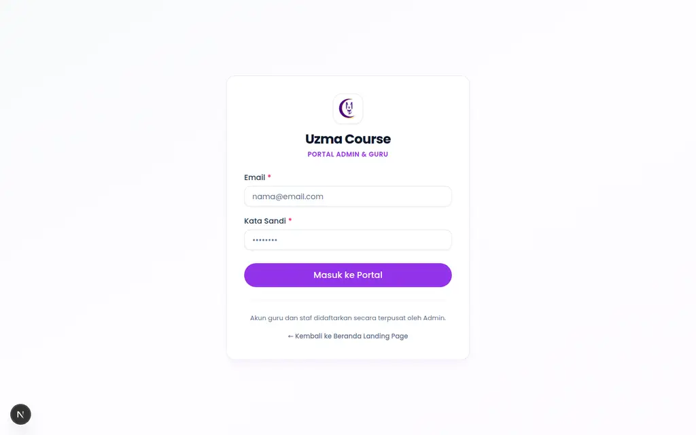
*Gambar 1: Halaman Login Tunggal Portal Admin & Guru*

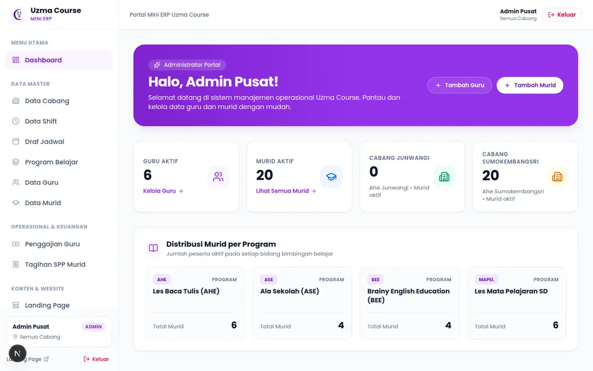
*Gambar 2: Dashboard Overview Admin dengan Statistik Operasional Real-time*

---
### 2.2 Kelola Data Master

#### A. Data Cabang (`/admin/cabang`)
- Menampung lokasi fisik operasional (misal: *Sumokembangsri*, *Junwangi*).
- Setiap cabang memiliki titik koordinat GPS (Latitude & Longitude) dan batas radius toleransi presensi (meter) yang digunakan untuk validasi absensi guru.
- Terdapat tombol status aktif/non-aktif cepat (*BranchStatusButton*).

#### B. Data Shift Belajar (`/admin/shift`)
- Mengatur jendela jam operasional mengajar (misal: *Shift Pagi: 08:00 - 11:00*, *Shift Siang: 13:00 - 16:00*).
- Jam shift menjadi batas mutlak pembuatan kelas di papan jadwal.

#### C. Program Belajar & Varian (`/admin/program`)
- Mengatur paket edukasi (AHE Baca, ASE Hitung, BEE English, dll).
- Di dalam setiap program, tentukan **Varian**:
  - `Durasi (menit)`: misal 30 menit atau 60 menit.
  - `Sistem (Rasio)`: rasio murid per kelas (1 = privat, 2 = semi-privat, 4+ = reguler).
  - `Frekuensi`: jumlah pertemuan per minggu (misal: 2x seminggu, 3x seminggu).
  - `Fee Guru per Sesi`: honor yang diterima guru saat mengajar sesi varian tersebut.
  - `Default SPP`: biaya standar paket untuk siklus belajar 28 hari per enrollment, bukan penagihan otomatis per bulan kalender.

#### D. Data Guru / Pendidik (`/admin/guru`)
- Mendaftarkan profil guru baru, cabang penempatan utama, cabang sekunder (multi-cabang), dan kontak WhatsApp.
- **Pengaturan Tunjangan & Garansi**:
  - Tunjangan Tetap: Tambahkan komponen tunjangan bulanan (Transport, Kreativitas, dll).
  - Garansi Honor Minimum: nominal terdaftar untuk ditinjau terhadap ketentuan kompensasi. Nilai ini disnapshot sebagai informasi, bukan otomatis ditambahkan sebagai top-up ke total honor. Admin harus meninjau selisih yang perlu disesuaikan sebelum pembayaran.

#### E. Data Murid (`/admin/murid`)
- Mendaftarkan murid baru beserta data wali/orang tua dan nomor WhatsApp aktif.
- **Penomoran Otomatis**: Sistem secara otomatis menerbitkan Nomor Induk Siswa (NIS) 5 digit berformat baku (misal: `01001` untuk Sumokembangsri, `02001` untuk Junwangi).
- Hubungkan murid ke program belajar yang diambil, tentukan nominal SPP khusus jika berbeda dari standar, serta tanggal awal siklus belajar (`cycle_start_date`).

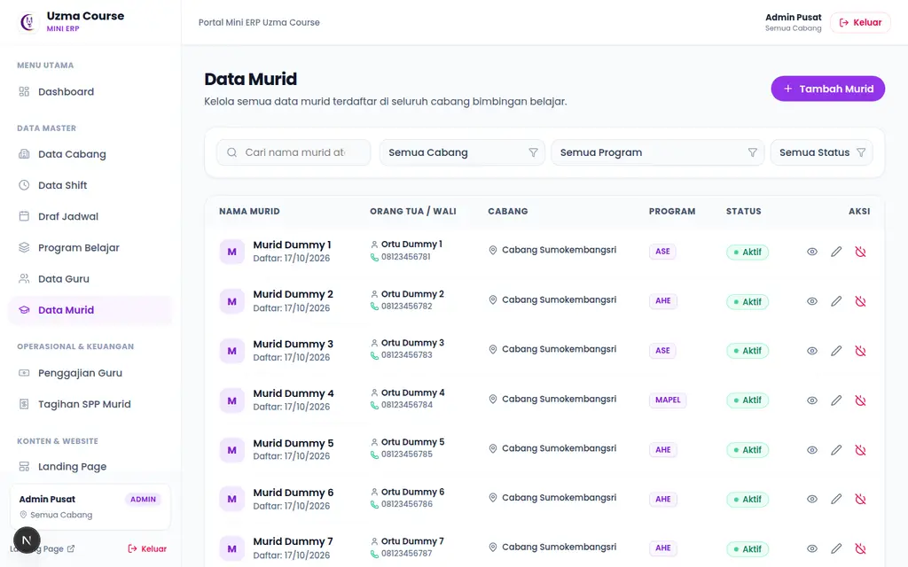
*Gambar 3: Pengelolaan Data Murid dengan Penomoran NIS 5 Digit Otomatis*

---

### 2.3 Penyusunan Jadwal Kelas (Kanban Board)
Rute: `/admin/draft` $\rightarrow$ `/admin/draft/[id]/board`

1. **Membuat Draf Jadwal**:
   - Buat draf baru untuk cabang tertentu, tentukan nama (misal: *"Draf Semester Genap"*).
   - Klik **"Buka Papan Jadwal"**.
2. **Menempatkan Kelas ke Kolom Shift**:
   - Klik tombol **"+ Tambah Kelas"** pada kolom shift yang diinginkan.
   - Pilih Guru dan Varian Program.
   - Tentukan jam mulai dan jam selesai kelas. Sistem memvalidasi jam harus berada di dalam jam kerja shift.
3. **Menambahkan Murid ke Kelas**:
   - Pada kartu kelas yang terpasang, klik **"+ Tambah Murid"**.
   - Pilih murid yang terdaftar. Sistem memeriksa:
     - Murid belum melebihi frekuensi mingguan paketnya.
     - Kelas belum melebihi kapasitas rasio sistem.
4. **Pencegahan Bentrok Multi-Cabang**:
   - Sistem secara otomatis menolak alokasi bila guru yang sama telah dijadwalkan di cabang lain pada jam yang beririsan (*overlap*).

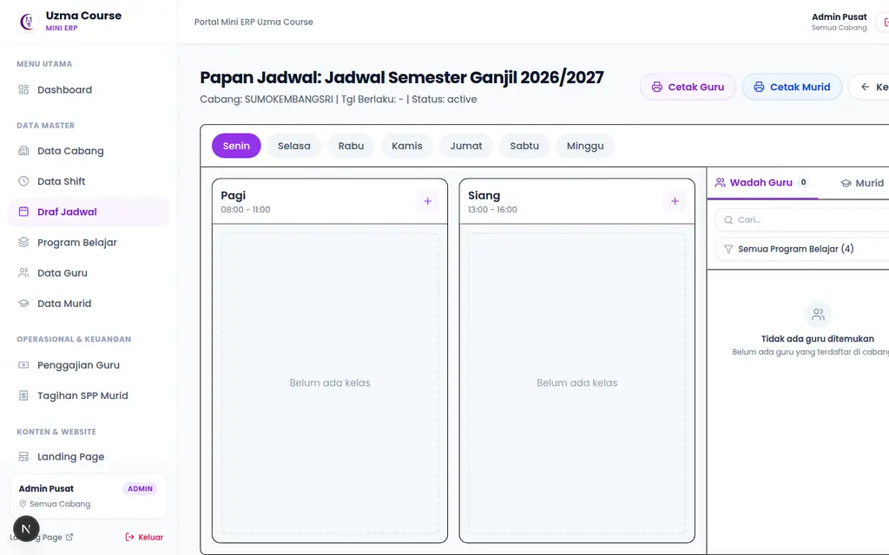
*Gambar 4: Papan Penjadwalan Kanban Bebas Bentrok Lintas Cabang*

---

### 2.4 Modul Penggajian Guru (Payroll)
Rute: `/admin/payroll`

1. **Siklus Periode Penggajian**:
   - Periode berstatus **Terbuka (`open`)**: Guru dapat mengisi kartu mengajar; estimasi guru memakai sesi submitted yang diakui. Entry rekap admin dapat belum terbentuk sampai penutupan, sehingga angka nol belum membuktikan tidak ada aktivitas.
   - **Tutup Periode Payroll**:
     - Di akhir bulan kalender, klik tombol **"Tutup Periode Payroll"**.
     - Sistem secara atomik menarik seluruh sesi mengajar tersubmit, membekukan *snapshot* tunjangan tetap dan garansi minimum, serta mengubah status menjadi **Ditutup (`closed`)**.
2. **Penambahan Penyesuaian (Adjustment)**:
   - Hanya pada status **`closed` sebelum `paid`**, klik **"+ Tambah Adjustment"**. Adjustment tidak ditambahkan pada periode terbuka atau yang sudah dibayar.
   - Masukkan nominal positif (bonus/lembur) atau negatif (potongan/denda) beserta alasan tertulis.
   - Total honor guru dan grand total payroll terhitung bersih secara otomatis.
3. **Pencairan Honor (*Mark Paid*)**:
   - Setelah transfer honor dilakukan, klik tombol **"Tandai Sudah Dibayar"**.
   - Tindakan ini mencatat status akhir **`paid`** dan mengunci perubahan yang tidak diizinkan. Tombol tidak melakukan transfer bank; cocokkan penerima, total dan bukti pembayaran nyata sebelum memilihnya.

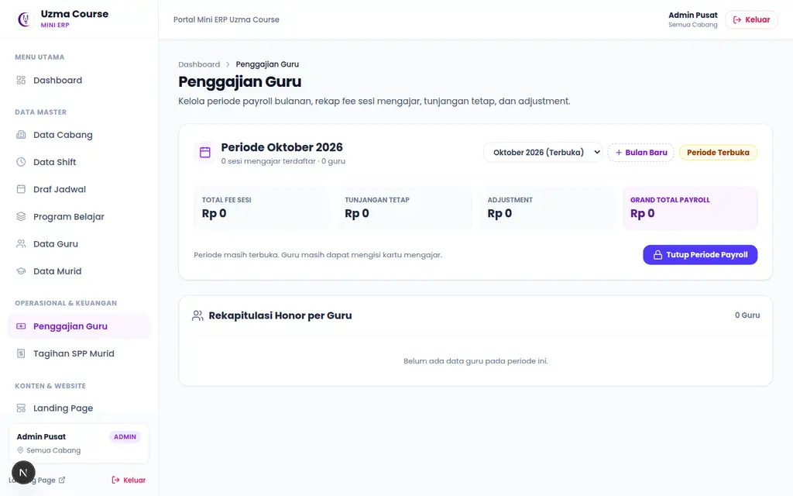
*Gambar 5: Rekapitulasi Penggajian Guru dan Penguncian Periode Otomatis*

---

### 2.5 Modul Tagihan SPP Murid & Kwitansi Resmi
Rute: `/admin/spp`

#### A. Konsep Siklus Belajar 28 Hari (*Rolling 28-Day Cycle*)
- Pendaftaran murid di Uzma Course berlangsung fleksibel (*rolling*). Sistem tidak memaksakan penagihan harus tanggal 1 kalender, melainkan menghitung periode belajar per 28 hari sejak tanggal aktif murid (`cycle_start_date`).
- Contoh: Murid aktif per tanggal 5 Oktober, maka Siklus 1 berlaku 5 Okt – 1 Nov, dan Siklus 2 berlaku 2 Nov – 29 Nov.

#### B. Menerbitkan Tagihan Siklus
1. Di halaman `/admin/spp`, klik tombol **"+ Terbitkan Tagihan Siklus"**.
2. Sistem secara otomatis mengevaluasi seluruh murid aktif dan menerbitkan faktur tagihan piutang dengan format sekuensial resmi: `INV-YYMM-NNNN` (misal: `INV-2610-0001`).
3. Sistem bersifat *idempotent*: klik berulang tidak akan menggandakan tagihan pada siklus yang sama.

#### C. Mencatat Pembayaran Kas Masuk (*Record Payment*)
1. Pada baris murid berstatus **Belum Bayar**, klik tombol **"Catat Bayar"**.
2. Pilih metode pembayaran:
   - Tunai (Cash di Cabang)
   - Transfer Bank (BCA, BRI, Mandiri)
   - QRIS
3. Masukkan tanggal penerimaan kas dan nomor referensi mutasi bank (opsional).
4. Klik **"Simpan Pembayaran & Terbitkan Kwitansi"**.
5. Sistem secara otomatis:
   - Mengubah status tagihan menjadi **Lunas**.
   - Mengurangi piutang tertunggak dan menambah kas diterima pada kartu KPI.
   - Menerbitkan dokumen resmi kas masuk dengan nomor kwitansi: `RCT-YYMM-NNNN` (misal: `RCT-2610-0001`).

#### D. Melihat & Mencetak Kwitansi Resmi Digital
1. Pada tagihan yang telah lunas, klik tombol **"Lihat Kwitansi"**.
2. Muncul dokumen resmi kwitansi kas masuk dengan stempel **LUNAS**, rincian program, periode siklus 28 hari, dan penerima kas.
3. Klik tombol **"Cetak Kwitansi"** untuk mencetak fisik atau menyimpan sebagai file PDF rapi tanpa elemen navigasi website.

#### E. Mengirim Pengingat Tagihan WhatsApp ke Orang Tua
1. Pada baris tagihan murid yang belum lunas, klik ikon **WhatsApp**.
2. Browser akan otomatis membuka chat WhatsApp ke nomor orang tua (`parent_phone`) dengan draf pesan sopan yang memuat rincian nama ananda, nomor tagihan, nominal, dan batas jatuh tempo.

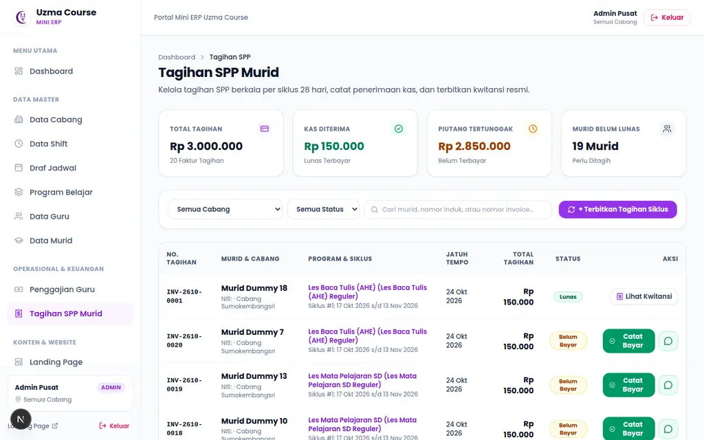
*Gambar 6: Dashboard Tagihan SPP Murid Siklus 28 Hari dengan 4 Kartu KPI*

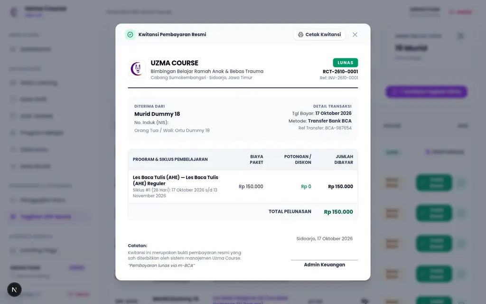
*Gambar 7: Dokumen Kwitansi Resmi Digital Berstempel LUNAS Siap Cetak*

---
### 2.6 Pengelolaan Konten Website (Landing Page CMS)
Rute: `/admin/landing`

- Mengelola 14 seksi tampilan website publik (`https://uzmacourse.com`):
  - Hero Banner, Program Belajar, Keunggulan (Why Us), Fasilitas, Tim Pengajar, Galeri Foto Autentik, Testimoni Orang Tua, Video Pembelajaran (YouTube & TikTok Player), Lokasi Cabang & Peta, FAQ, CTA Pendaftaran, Footer, Navbar, dan Floating WhatsApp.
- Mengunggah foto langsung menormalkan URL dan memvalidasi keamanan tautan video shortlink secara otomatis.

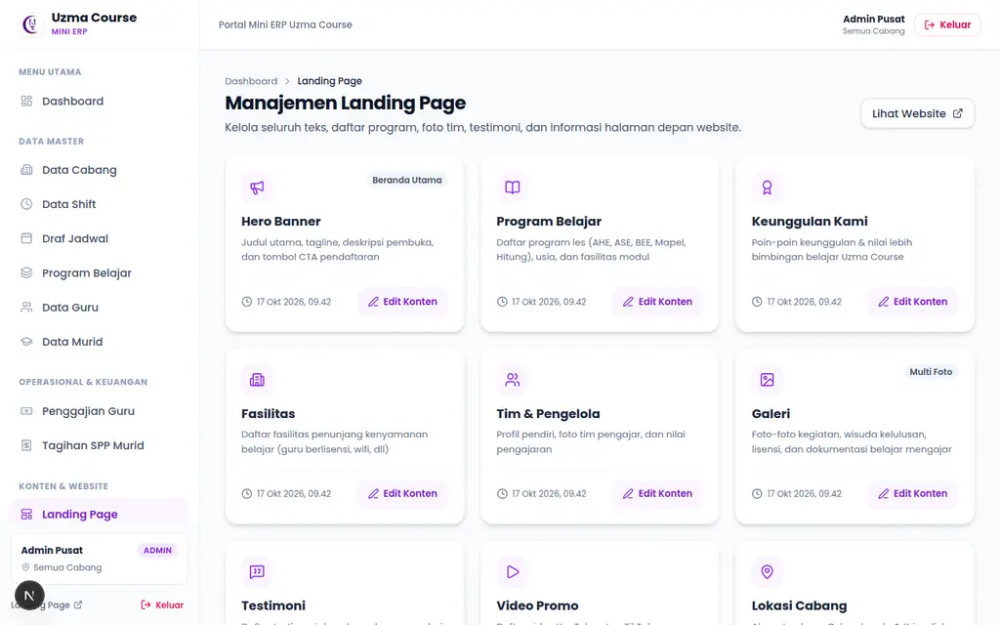
*Gambar 8: Dasbor Pengelolaan Konten Website Publik (14 Seksi Dinamis)*

---

## 3. Panduan Operasional Portal Guru (PWA Mobile)

### 3.1 Pemasangan Aplikasi PWA di Smartphone
1. Buka browser ponsel (Safari di iPhone, Chrome di Android).
2. Kunjungi alamat: `https://uzmacourse.com/guru` (atau login terlebih dahulu).
3. **Pengguna Android (Chrome)**:
   - Ketuk menu titik tiga di kanan atas $\rightarrow$ pilih **"Instal Aplikasi"** atau **"Tambahkan ke Layar Utama"**.
4. **Pengguna iPhone (Safari)**:
   - Ketuk tombol **Share** (ikon kotak dengan panah ke atas) $\rightarrow$ gulir ke bawah $\rightarrow$ pilih **"Add to Home Screen" (Tambahkan ke Layar Utama)**.
5. Ikon **Uzma Course** akan muncul di layar utama HP Anda dan dapat dibuka instan layaknya aplikasi native tanpa bilah alamat browser.

  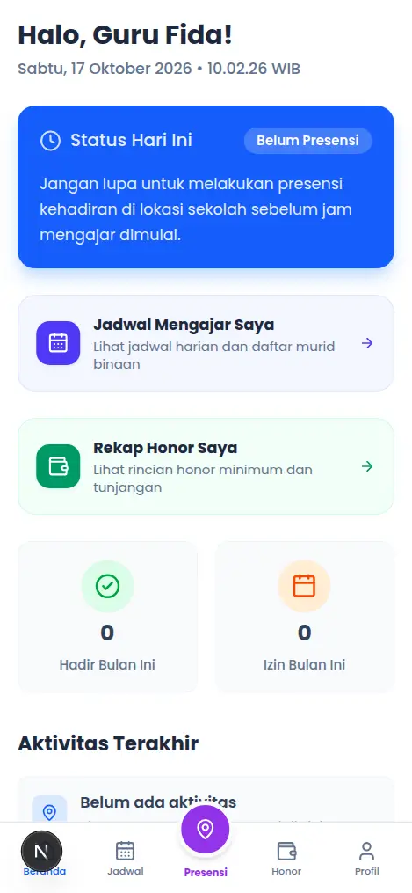
  
<em>Gambar 9: Beranda Guru PWA Mobile</em>

---
### 3.2 Presensi Kehadiran Berbasis Geofence GPS
Rute: `/guru/absen`

1. Masuk ke menu **Presensi** di navigasi bawah.
2. Saat pertama kali membuka, browser akan meminta izin lokasi: pilih **"Izinkan Saat Menggunakan Aplikasi" (Allow)**.
3. Periksa cabang tugas yang dipilih atau disarankan sebagai terdekat. Pilihan mengikuti penugasan dan jadwal aktif hari ini; **Hari Ini Libur** berarti tidak ada jadwal yang ditemukan untuk hari tersebut. Kesalahan penugasan/jadwal harus dilaporkan kepada admin.
4. **Presensi Datang**:
   - Periksa jarak GPS dan radius toleransi cabang yang tampil; berada dalam radius kerja yang benar adalah prasyarat, bukan mengikuti angka contoh pada screenshot.
   - Ketuk **"Check-In"**, tunggu hasil, lalu periksa **Sudah Masuk** serta jumlah **Antrean**. Status optimistis saat offline belum berarti server sudah menerima catatan.
5. **Presensi Pulang**:
   - Setelah tugas selesai, buka kembali presensi dan pilih **"Check-Out"**. Pastikan hasil tersimpan/sinkron. Antrean lokal jangan dihapus dan harus diselesaikan sebelum keluar atau mengganti akun/perangkat.

  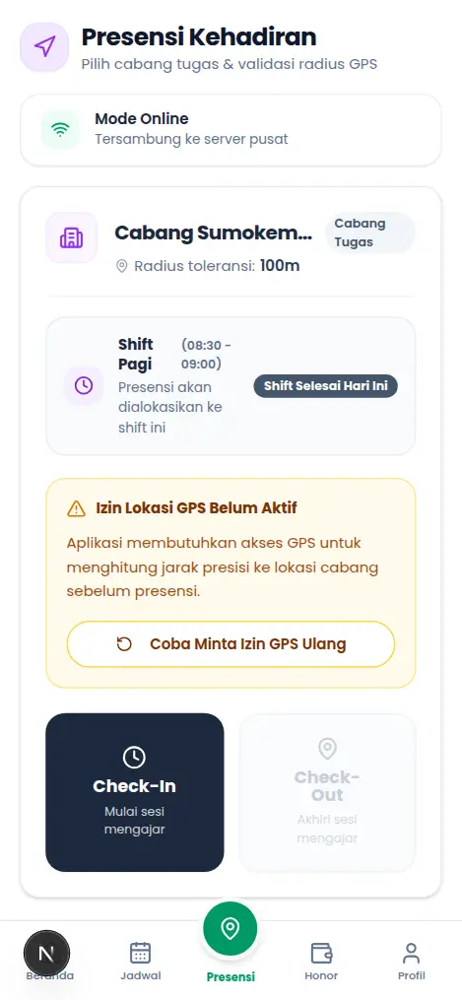
  
<em>Gambar 10: Presensi GPS Geofence Cabang</em>

---
### 3.3 Jadwal Mengajar Harian
Rute: `/guru/jadwal`

- Menampilkan daftar kelas yang ditugaskan kepada Anda sesuai hari yang dipilih (Senin s/d Minggu).
- Setiap kartu kelas menampilkan: jam mengajar, nama varian program, cabang, jumlah murid terdaftar, dan tautan langsung ke kartu mengajar.

  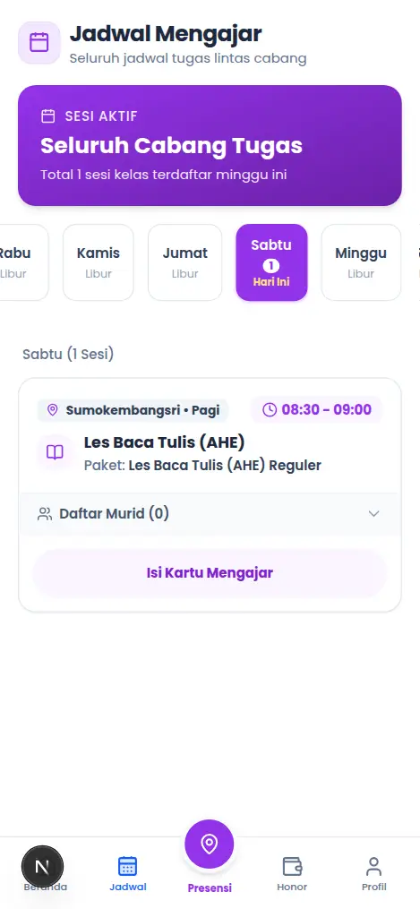
  
<em>Gambar 11: Jadwal Mengajar Harian</em>

---

### 3.4 Pengisian Kartu Kendali Mengajar (Teaching Log)
Rute: `/guru/jadwal` $\rightarrow$ Ketuk **"Isi Kartu Mengajar"**

1. **Pemilihan Tanggal**:
   - Periksa tanggal yang dibuka dari tautan jadwal; tanggal itu dapat menunjuk pertemuan terakhir sesuai hari kelas. Pilih tanggal pertemuan yang benar, sesuai hari jadwal dan tidak di masa depan menurut WIB, sebelum mengisi.
2. **Status Kehadiran Murid**:
   - Pilih status tiap murid: **Hadir (`present`)**, **Tidak Hadir (`absent`)**, **Izin (`excused`)**, atau **Cancel (`cancelled`)**. Semua murid wajib memiliki status sebelum kartu dikirim.
3. **Capaian & Catatan Guru**:
   - Ketikkan capaian belajar ananda pada sesi tersebut (misal: *"Membaca Modul 3 Halaman 12-14"*).
   - Berikan catatan perkembangan atau evaluasi fokus belajar.
4. **Simpan Draft vs Kirim Kartu**:
   - **Simpan Draft**: Menyimpan pekerjaan ke server tanpa mengirim kartu final. Tunggu pesan berhasil dan periksa kelas/tanggal yang sama ketika melanjutkan; antrean offline presensi tidak menyimpan kartu mengajar.
   - **Kirim Kartu**: Menyimpan perubahan saat ini lalu mengirim dan mengunci kartu sebagai **Submitted**. Periksa seluruh murid, tanggal dan catatan sebelum tindakan final.

  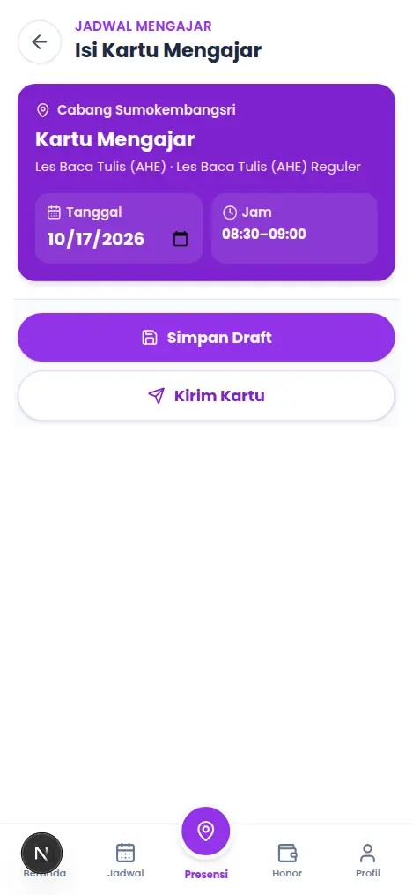
  
<em>Gambar 12: Kartu Kendali Mengajar Murid Digital</em>

---

### 3.5 Slip & Estimasi Honor Guru
Rute: `/guru/honor`

1. **Estimasi Berjalan (Bulan Aktif)**:
   - Menampilkan estimasi dari kartu submitted pada periode berjalan dan komponen yang diakui. Fee sesi standar saat ini memakai status Hadir; Tidak Hadir/Izin/Cancel tidak menambah fee sesi tersebut.
   - Rincian tunjangan dan **Garansi Minimum Terdaftar** dibaca terpisah dari total. Minimum terdaftar bukan komponen top-up otomatis; minta admin memeriksa ketidaksesuaian dengan ketentuan kompensasi.
2. **Arsip Slip Resmi Periode Lampau**:
   - Buka **Pilih Periode Honor** dan gunakan pilihan yang tersedia untuk akun sendiri. Cocokkan bulan/tahun pada rekap, bukan hanya URL.
   - **Estimasi Berjalan**, **Periode Ditutup / Menunggu Transfer**, dan **Sudah Ditransfer / Paid** memiliki arti berbeda. Status pembayaran dicatat admin, bukan bukti aplikasi memverifikasi mutasi bank; laporkan arsip yang tidak tersedia atau penerimaan nyata yang tidak sesuai.

  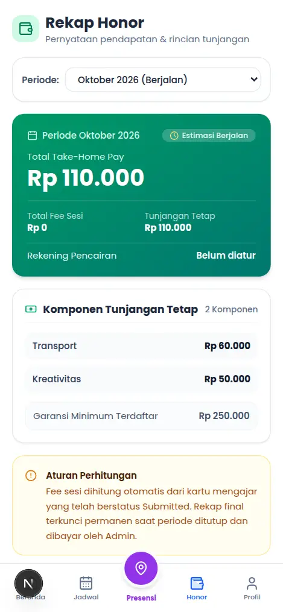
  
<em>Gambar 13: Slip Rekapitulasi Honor & Tunjangan Guru PWA</em>

---

## 4. Tanya Jawab & Pemecahan Masalah (FAQ)

### Q1: Mengapa Check-In tidak dapat diselesaikan?
> **Jawaban:** Periksa identitas akun, penugasan cabang, jadwal aktif hari ini, izin/akurasi GPS, cabang terpilih, jarak dan radius yang ditampilkan. Jika **Hari Ini Libur** atau penugasan berbeda muncul padahal seharusnya bertugas, laporkan kelas, cabang, tanggal dan jam kepada admin. Jangan mengubah tanggal perangkat atau memalsukan lokasi. Bila ada **Antrean**, selesaikan sinkronisasi pada akun/perangkat asal sebelum mengulang tindakan.

### Q2: Saya terlanjur klik "Kirim Kartu" padahal ada catatan murid yang salah ketik. Apakah bisa diedit kembali?
> **Jawaban:** Kartu **Submitted** bersifat hanya-baca. Catat kelas, tanggal sesi, murid dan rincian koreksi yang diperlukan, lalu hubungi admin. Tidak ada alur buka-kembali/unsubmit yang dijanjikan oleh panduan ini; jangan mengubah database atau membuka kunci kartu secara langsung.

### Q3: Saat mencetak Kwitansi SPP, bagaimana cara menghilangkan teks URL dan tanggal di header/footer kertas?
> **Jawaban:** Pada jendela pratinjau cetak (*Print Preview*) browser:
> 1. Klik menu **More Settings (Pengaturan Lainnya)**.
> 2. Hilangkan centang pada opsi **"Headers and footers" (Header dan footer)**.
> 3. Pastikan opsi **"Background graphics" (Grafik latar belakang)** tercentang agar warna dan logo tercetak sempurna.

### Q4: Apakah data draf kartu mengajar akan hilang jika ponsel tiba-tiba mati atau kehabisan baterai?
> **Jawaban:** Data dapat dilanjutkan jika **Simpan Draft** benar-benar berhasil di server. Tunggu pesan tersimpan dan buka kelas/tanggal yang sama untuk memeriksa hasilnya. Mengetik tanpa menyimpan, atau gagal simpan saat offline, tidak menjamin data bertahan. Antrean offline yang didukung di sini adalah presensi, bukan seluruh isian kartu mengajar.

---

*Ringkasan Markdown diperbarui: 24 Oktober 2026. PDF/HTML arsip tidak diregenerasi; panduan web sesuai peran adalah rujukan langkah terkini.*
