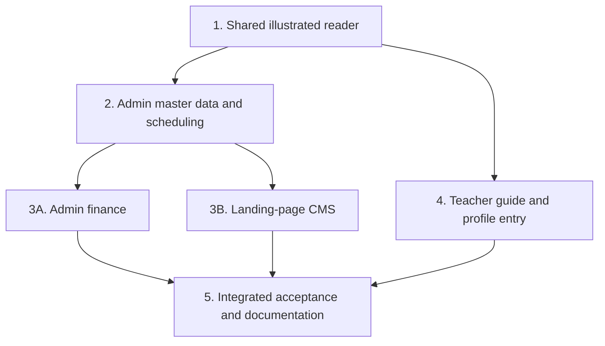

# Role-Specific User Guides Implementation Plan

> **For agentic workers:** REQUIRED SUB-SKILL: Use superpowers:subagent-driven-development (recommended) or superpowers:executing-plans to implement this plan task-by-task. Steps use checkbox (`- [ ]`) syntax for tracking.

**Goal:** Deliver separate, protected Indonesian admin and teacher guides with complete task instructions, authentic screenshots, system rules, practical advice, and troubleshooting.

**Architecture:** Use separate server-only role content modules and two guarded App Router pages. A shared server-rendered illustrated reader passes only the current role's navigation metadata and the selected article's rendered children into small client components for search, mobile contents, screenshot zoom, and printing. Keep all ERP/authentication business logic unchanged.

**Tech Stack:** Existing Next.js 16.3.7, React 19.2.8, TypeScript, Tailwind CSS v4, Lucide, Vitest 5/happy-dom, and Supabase local demo environment. No new dependencies.

**Spec:** `docs/superpowers/specs/2026-10-24-role-specific-user-guides-design.md` — approved by the user on 2026-10-24 after selecting **Langkah bergambar**.

## Global Constraints

- Routes are `/admin/panduan` and `/guru/panduan`; use `requireAdminPage()` and `requireGuruPage()` respectively. Do not add admin impersonation or cross-role access.
- Use Indonesian copy and the application's exact current control labels. Distinguish **Aturan sistem** from **Saran penggunaan**.
- Server-render articles and import each role's content only through its own guarded entry point. Do not send both guide bodies to a shared client component.
- Missing or unknown `topik` selects that role's getting-started article. Repeated query values (`string[]`) also fall back; only a single known slug selects another article.
- Preserve Poppins, the existing purple/slate identity, rounded containers, pill actions, UI primitives, and teacher `max-w-md` layout. No new visual-world round is needed.
- Body instructions are at least 14px; mobile form/search text is at least 16px; new interaction targets are at least 44px. Verify 360px, 375px, and 1280px+ with zero horizontal overflow and no clipped controls.
- `GuideReader` owns a visible-on-focus **Langsung ke panduan** link to `#guide-article`; `GuideArticleContent` renders `<article id="guide-article" tabIndex={-1} aria-labelledby="guide-topic-title">` with the task title in `<h2 id="guide-topic-title">`. Verify Enter on that skip link moves article focus during Task 5's keyboard pass.
- Publish only sanitized, genuine demo screenshots under `public/guides/admin/` and `public/guides/guru/`, never the ignored `public/docs/`. Public image URLs are not authenticated; protected pages do not make their image URLs private.
- Each tutorial needs prerequisites, numbered steps, relevant screenshots, observable outcomes, real system rules, and contextual help. No placeholder articles, generated UI screenshots, stock images, or mock business behavior.
- No new database schema, permissions, dependencies, operational features, service-worker caching rules, automated WhatsApp delivery, or dedicated PDF generation.
- Offline instructions describe the existing attendance queue only. Never promise offline teaching-card saves or universal PWA offline operation.
- Preserve the original PDF as an archive; update the existing Markdown manual to point to the role-specific guides and remove contradictory/unsupported advice.
- Keep existing coverage floors: statements 58%, lines 58%, functions 60%, branches 56%. Do not lower them or add copy/source-string tests to make coverage green.
- Only the integration owner runs checks. Delegated implementers must skip build/lint/tests/formatters mid-flight. The owner runs the specified focused checks and one final `./init.sh` after integration.
- Do not deploy or mark `feat-012` completed between tasks. Every intermediate commit contains real implemented behavior, but the feature is delivered only after all guide coverage and final verification are complete.

## Review Focus

1. Invalid, repeated, prototype-looking, and other-role `topik` values must never select arbitrary files or another role's article — permanent selector tests in Task 1; authenticated deep-link smoke in Tasks 2/4/5.
2. Search whitespace/case, no matches, clearing, and new server-selected topic props must not leave stale navigation or steal focus while typing — helper/UI regression tests in Task 1 and browser navigation checks in Task 5.
3. A long Indonesian task label or screenshot must remain usable on a 360px phone; screenshot open/Escape/close must restore focus to the correct opener — browser tests in Tasks 2/4/5, not happy-dom claims about native dialog behavior.
4. Teacher HTML/RSC/navigation must contain only teacher content; publicly retrievable screenshots must contain no real contacts, credentials, or operational records — actual role/payload and image audit in Task 5.
5. Printing must reveal closed help answers, retain warnings/images, hide surrounding app navigation, and restore disclosure/body state afterward — native browser print/PDF test in Task 5.

---

## File Map and Ownership

| Files | Responsibility / owner |
|---|---|
| `src/types/guides.ts` | Read-only guide, chapter, article, step-group, screenshot, and navigation contracts; Task 1 |
| `src/lib/guides/navigation.ts` | Pure topic resolution and navigation/search indexing; Task 1 |
| `src/components/guides/guide-reader.tsx`, `guide-article.tsx` | Server-side composition and selected article rendering; Task 1 |
| `src/components/guides/guide-shell.tsx`, `guide-figure.tsx`, `guide-print-button.tsx` | Small client interaction boundaries; Task 1 |
| `src/app/globals.css` | Print rules scoped strictly to the guide print state; Task 1 |
| `src/lib/guides/admin.ts`, `src/lib/guides/admin/*.ts`, `public/guides/admin/*.png` | Admin content and fixed screenshot metadata; Tasks 2, 3A, and 3B |
| `src/app/admin/panduan/page.tsx`, `src/components/admin/admin-shell.tsx` | Guarded admin route, help entry, and print markers; Task 2 |
| `src/lib/guides/guru.ts`, `src/lib/guides/guru/*.ts`, `public/guides/guru/*.png` | Teacher content and screenshot metadata; Task 4 |
| `src/app/guru/panduan/page.tsx`, `src/app/guru/profil/page.tsx`, `src/app/guru/layout.tsx`, `src/components/guru/guru-bottom-nav.tsx` | Guarded teacher route, profile entry, and print markers without a sixth tab; Task 4 |
| `tests/guides.test.ts`, `tests/components/guide-shell.test.tsx` | Consumer-visible query/search/navigation regressions; Task 1 |
| `docs/buku-panduan-pengguna.md`, `feature_list.json`, `progress.md`, `session-handoff.md` | Final links, honest feature status, and exercised evidence; integration owner, Task 5 |

New guide code follows the existing `src/lib/`, `src/types/`, and feature-component patterns rather than adding a separate content framework. Keep authored chapters in focused files; do not put the entire manual into one client component.



### Existing Source and Runtime Prerequisites

- Installed docs already checked: `node_modules/next/dist/docs/01-app/03-api-reference/03-file-conventions/page.md`, `02-components/link.md`, and `01-getting-started/05-server-and-client-components.md`.
- `searchParams` is a `Promise`; repeated values are arrays. Await it on the server. Do not introduce `useSearchParams` for article resolution or a client-only rendering fallback.
- `server-only` imports are handled by Next itself; no dependency installation is needed. Mark role definition, chapter, and screenshot-metadata modules with `import "server-only"`.
- Reuse `PageHeader` from `src/components/admin/page-header.tsx`, `Button` from `src/components/ui/button.tsx`, and `cn()` from `src/lib/utils.ts`. Use `next/link` directly for topic navigation: the existing `Button` `href` branch renders a plain anchor and does not forward navigation event props.
- Use `prefetch={false}` for guide topic/previous/next links to avoid speculative rendering of the entire manual. URLs use `?topik=<encoded-slug>#guide-article`.
- LSP currently reports no configured server. Use the CodeGraph source/caller trails already available; if LSP becomes available, use it for references before exported-symbol edits.
- Baseline has already passed this session: `./init.sh`, 80 suites / 462 tests, lint, and build. On a fresh execution session, follow the repository startup workflow before editing.
- Screenshot app port 3000 and companion port 5180 are registered in `~/projects/PORT_MAPPING.md` and `ports.json`. Recheck listeners and registries before restarting; do not create an unregistered fallback server.
- Use the existing local demo accounts through private credentials, never copied into guide content, scripts committed to git, or logs. Verify actual Supabase auth/data network origins are local (`127.0.0.1:54321` or equivalent approved localhost origin) before any capture preparation. No production writes.

## Shared Contracts — Defined by Task 1

In `src/types/guides.ts`, export these named interfaces/types. All content fields and arrays are read-only.

```ts
export type GuideRole = "admin" | "guru";
export interface GuideScreenshot {
  readonly src: `/guides/${GuideRole}/${string}.png`;
  readonly width: number;
  readonly height: number;
  readonly alt: string;
  readonly caption: string;
  readonly sourceRoute: string;
  readonly state: string;
}
export interface GuideStep {
  readonly title: string;
  readonly paragraphs: readonly string[];
}
export interface GuideStepGroup {
  readonly id: string;
  readonly steps: readonly GuideStep[];
  readonly screenshots: readonly GuideScreenshot[];
  readonly warning?: string;
}
export interface GuideArticle {
  readonly slug: string;
  readonly title: string;
  readonly summary: string;
  readonly keywords: readonly string[];
  readonly prerequisites: readonly string[];
  readonly groups: readonly GuideStepGroup[];
  readonly expected: readonly string[];
  readonly systemRules: readonly string[];
  readonly recommendations: readonly string[];
  readonly troubleshooting: readonly { question: string; answer: string }[];
}
export interface GuideChapter {
  readonly id: string;
  readonly title: string;
  readonly articles: readonly GuideArticle[];
}
export interface GuideDefinition {
  readonly role: GuideRole;
  readonly title: string;
  readonly description: string;
  readonly defaultTopic: string;
  readonly chapters: readonly GuideChapter[];
}
export interface GuideIndexItem {
  readonly slug: string;
  readonly title: string;
  readonly chapterTitle: string;
  readonly searchText: string;
}
```

`src/lib/guides/navigation.ts` exports:

- `createGuideIndex(guide: GuideDefinition): readonly GuideIndexItem[]`: preserve chapter/article order; precompute lower-case Indonesian search text from title, chapter, and keywords once per role-module initialization.
- `resolveGuideArticle(guide: GuideDefinition, topic: string | string[] | undefined): GuideArticle`: strict single-string slug match inside the supplied guide; otherwise return its default article. Throw for an authored guide with no valid default, rather than silently inventing content. Never use the query as a property on an ordinary inherited object or as an asset/file path.
- `filterGuideIndex(index: readonly GuideIndexItem[], query: string): readonly GuideIndexItem[]`: trim and case-fold the query with `id-ID`; substring match against precomputed search text; return the original index for an empty query. No fuzzy search, persistence, telemetry, or extra normalization service.

Component signatures, with named exported props interfaces:

- `GuideReader({ guide, index, topic }: GuideReaderProps): ReactElement`, server; `guide: GuideDefinition`, `index: readonly GuideIndexItem[]`, `topic: string | string[] | undefined`.
- `GuideArticleContent({ article }: GuideArticleContentProps): ReactElement`, server; `article: GuideArticle`.
- `GuideShell({ role, basePath, index, activeSlug, children }: GuideShellProps): ReactElement`, client; `role: GuideRole`, `basePath: "/admin/panduan" | "/guru/panduan"`, navigation index only, `activeSlug: string`, and server-rendered `children: ReactNode`.
- `GuideFigure({ src, width, height, alt, caption }: GuideFigureProps): ReactElement`, client; only the selected screenshot's display fields. Keep `sourceRoute`/`state` in the server authoring model rather than serializing unused provenance metadata. This is the recorded Task 1 execution ruling.
- `GuidePrintButton(): ReactElement`, client; prints the currently rendered reader, never fetches all articles or creates a separate generated PDF.

## Task 1: Shared Illustrated Reader and Its Consumer Boundaries

**Files:** Create the seven shared type/lib/component files in the map, plus `tests/guides.test.ts` and `tests/components/guide-shell.test.tsx`. Modify only the scoped print section in `src/app/globals.css`.

**Interfaces:** Produces all Shared Contracts above. No role content or routes are needed to unit-test these contracts. Later tasks supply complete authored guides and real assets; do not create temporary production routes or placeholder manuals.

- [ ] **Step 1: Write permanent query/search regression cases.** In `tests/guides.test.ts`, use explicit synthetic admin/guru guide fixtures with default slug `mulai` and an additional admin slug `spp-catat-pembayaran`. Give the SPP article keyword `kwitansi`. These are selector/search fixtures, not copies of production prose. Pin these behaviors:

```ts
expect(resolveGuideArticle(adminFixture, "spp-catat-pembayaran").slug)
  .toBe("spp-catat-pembayaran");
for (const value of [undefined, "unknown", "__proto__", ["mulai", "spp-catat-pembayaran"]]) {
  expect(resolveGuideArticle(adminFixture, value).slug).toBe("mulai");
}
expect(resolveGuideArticle(guruFixture, "spp-catat-pembayaran").slug).toBe("mulai");
expect(filterGuideIndex(createGuideIndex(adminFixture), "  KWITANSI  ").map(x => x.slug))
  .toEqual(["spp-catat-pembayaran"]);
expect(filterGuideIndex(createGuideIndex(adminFixture), "no-such-task")).toEqual([]);
```

- [ ] **Step 2: Write `GuideShell` interaction regressions.** In `tests/components/guide-shell.test.tsx`, follow existing React Testing Library/Vitest cleanup conventions. Render synthetic metadata and a real focusable child article `id="guide-article"`. Test that a no-match search hides task links and shows a clear-search action; clearing restores them without changing the active article. Rerender with a newly selected slug and assert the correct link has `aria-current="page"` and the article receives focus; typing a filter alone must leave focus in the search field. Do not assert copied headings or navigation counts.

Use synthetic index labels **Intro fixture** and **Payment fixture**, slugs `mulai` and `spp-catat-pembayaran`, and a focusable child article in a local test helper `shell(activeSlug: string): ReactElement` that renders `GuideShell` with those props. Pin the interaction assertions, not production guide wording:

```tsx
it("recovers from no matches while preserving the selected topic", () => {
  render(shell("mulai"));
  const search = screen.getByRole("searchbox");
  search.focus();
  fireEvent.change(search, { target: { value: "no-such-task" } });
  expect(screen.queryByRole("link", { name: "Payment fixture" })).toBeNull();
  expect(document.activeElement).toBe(search);
  fireEvent.click(screen.getByRole("button", { name: "Hapus pencarian" }));
  expect(screen.getByRole("link", { name: "Payment fixture" })).not.toBeNull();
  expect(screen.getByRole("link", { name: "Intro fixture" }).getAttribute("aria-current"))
    .toBe("page");
});
it("tracks a newly selected server topic and moves article focus", () => {
  const { rerender } = render(shell("mulai"));
  rerender(shell("spp-catat-pembayaran"));
  expect(screen.getByRole("link", { name: "Payment fixture" }).getAttribute("aria-current"))
    .toBe("page");
  expect(document.activeElement).toBe(screen.getByRole("article"));
});
```

- [ ] **Step 3: Run the new tests before implementation.** Owner command: `npx vitest run tests/guides.test.ts tests/components/guide-shell.test.tsx --coverage.enabled=false`. Expected RED: missing guide modules/exports, not an unrelated configuration failure.
- [ ] **Step 4: Implement the type and navigation contracts.** Use direct iteration for resolution and one authored index per role. Keep the pure helper module client-safe and free of role-content imports.
- [ ] **Step 5: Implement `GuideArticleContent`.** Render escaped text through React, not Markdown/HTML injection. Use ordered lists with continuous numbering across short step groups. Each group has a text column and its associated screenshots on wide admin layouts; on compact/mobile layouts that same group puts its images immediately after its steps, without duplicated responsive DOM. Render prerequisites, expected results, system rules, recommendations, and native help disclosures separately. Warnings precede the affected group.
  Static article warnings use note/content semantics, not a transient `role="alert"` that print CSS would hide.
- [ ] **Step 6: Implement `GuideShell`.** Keep search input state separate from server-selected article props. Admin contents are visible on desktop; mobile and all guru layouts use an initially collapsed, labelled contents toggle with `aria-expanded`/`aria-controls`. Use one navigation DOM. On normal client navigation, close the mobile index using Link's `onNavigate`; do not close it for opening a new tab. Focus the article only after `activeSlug` changes, not on initial render or search keystrokes. Include clear-search/no-result recovery and `aria-current`.
- [ ] **Step 7: Implement `GuideReader`.** Resolve the article on the server; use `PageHeader` for the role title and print action. Derive previous/next links from the supplied role index; omit unavailable neighbors instead of rendering dead buttons. Pass only index metadata, active slug, role/path, and rendered current-article children to `GuideShell`. Never serialize `guide` or import admin/guru definitions from client files.
- [ ] **Step 8: Implement `GuideFigure`.** Use a real local PNG with intrinsic dimensions (`next/image` with `unoptimized` is appropriate for screenshot text fidelity). The clickable figure opens a labelled native dialog with a 44px close control, scrollable full-resolution image, Escape dismissal, and focus return. Keep every rendered image's `src` valid; no empty image awaiting initialization. Caption each state accurately and label demo data. Browser behavior, not happy-dom's native-dialog approximation, is the acceptance gate for focus/Escape.
- [ ] **Step 9: Implement `GuidePrintButton` and scoped print CSS.** Register `beforeprint`/`afterprint` once per mounted reader, so keyboard printing also works. Before print, set `body[data-guide-printing]` and snapshot/open only the current article's help disclosures; guard repeated `beforeprint` so the original states are not overwritten. After print or unmount, restore each disclosure and remove the body marker. Scope CSS under that marker: hide `[data-guide-print-hide]`, `[data-guide-screen-only]`, and transient status/alert chrome; reset `[data-guide-print-container]` padding/max-width/min-height/display; retain article headings, warnings, images, and help answers. Mark the contents, previous/next controls, zoom dialog, and print action screen-only. Do not apply any global print change outside this state.
- [ ] **Step 10: Run the focused regression files and commit.** Use the Step 3 command; expected GREEN for the stated consumer cases. Native browser/actual route tests follow when role pages exist. Commit the complete shared reader as `feat(guides): add illustrated task reader`.

## Task 2: Admin Master Data and Scheduling Guide

**Files:** Create `src/lib/guides/admin.ts`, the chapter and screenshot files listed below, `src/app/admin/panduan/page.tsx`, and genuine images under `public/guides/admin/`. Modify `src/components/admin/admin-shell.tsx:54-136,165-180,330-393`. Tasks 3A/3B extend this same role definition after Task 2; no empty future chapters are added now.

**Interfaces:** Consumes Task 1 contracts. Produces server-only `ADMIN_GUIDE: GuideDefinition`, `ADMIN_GUIDE_INDEX: readonly GuideIndexItem[]`, and `ADMIN_SCREENSHOTS` with authored keys corresponding to the filenames below. Default slug is `mulai`. The route accepts `searchParams: Promise<{ topik?: string | string[] }>` and calls `requireAdminPage()` before rendering `GuideReader`.

| Chapter file under `src/lib/guides/admin/` | Task slugs | Initial screenshot filenames under `public/guides/admin/` |
|---|---|---|
| `getting-started.ts` | `mulai`, `navigasi-filter`, `keluar` | `login-desktop.png`, `dashboard.png` |
| `branches.ts` | `cabang-tambah`, `cabang-lokasi`, `cabang-status` | `cabang-list.png`, `cabang-form.png`, `cabang-detail.png`, `cabang-status.png` |
| `programs.ts` | `program-varian`, `program-edit-status` | `program-list.png`, `program-form.png` |
| `shifts.ts` | `shift-tambah-edit`, `shift-status` | `shift-list.png`, `shift-form.png` |
| `teachers.ts` | `guru-akun`, `guru-penempatan-honor`, `guru-status` | `guru-list.png`, `guru-form.png`, `guru-detail.png` |
| `students.ts` | `murid-daftar`, `murid-enrollment`, `murid-status` | `murid-list.png`, `murid-form.png`, `murid-detail.png` |
| `scheduling.ts` | `jadwal-draf`, `jadwal-kelas`, `jadwal-murid`, `jadwal-status-cetak` | `jadwal-draf.png`, `jadwal-board.png`, `jadwal-kelas.png`, `jadwal-murid.png`, `jadwal-cetak.png` |
| `screenshots.ts` | Fixed `ADMIN_SCREENSHOTS` metadata, no query-derived paths | Each listed file's actual dimensions, route, state, alt text, caption |

- [ ] **Step 1: Ground the chapters in current controls.** Read the relevant admin routes/actions/DAL and the existing `cabang/branch-form.tsx`, `program/program-form.tsx`, `shift/shift-form.tsx`, `guru/guru-form.tsx`, `murid/student-form.tsx`, `draft/draft-form.tsx`, and `board/{kanban-board,add-class-modal,add-student-modal,class-time-modal}.tsx`. Verify all currently visible inputs and operations within the approved coverage. Draf statuses are `draft`/Draf, `active`/Aktif, and `archived`/Arsip; document supported transitions, not an invented publication state.
- [ ] **Step 2: Implement the admin route and help entry.** Give the page role-specific metadata and `noindex`; use the asynchronous query contract above. Append a **Bantuan** nav group with **Panduan Pengguna**, `BookOpen`, `/admin/panduan`, and `roles: ["admin"]`. Retain the existing drawer-closing behavior. Add `data-guide-print-hide` to the sidebar, drawer overlay, and app header, and `data-guide-print-container` to the shell root/main wrappers; do not otherwise restyle the shell.
- [ ] **Step 3: Capture real local admin evidence.** Reuse/start the registered loopback app with `npm run dev -- --hostname 127.0.0.1 --port 3000`. Use the browser tool at 1440×1000 with `deviceScaleFactor: 1`; capture the states in the table after the help entry is present. Open forms/confirmations without changing unrelated records. Use only explicitly dummy local transactions if a result state genuinely requires one. Record all owned capture-preparation IDs and restore/remove only owned changes. Existing source captures may be reused only after checking current controls, image format/dimensions, privacy, and visual freshness; do not blindly copy `docs/screenshots/` or the ignored preview assets.
- [ ] **Step 4: Author complete chapter data and metadata.** Write server-only chapter modules using the Shared Contracts, with images after relevant short step groups. Cover branch location/radius, program variant references, valid shift ranges/narrowing restrictions, multi-branch teacher/program assignments and compensation fields, student contact/enrollments/discounts/status distinctions, and scheduling bounds/conflicts/capacity/frequency. Explain exact fields from the current forms without inventing rates, NIS formats, or correction controls. Every task has relevant screenshot evidence and outcome/help sections.
- [ ] **Step 5: Exercise the admin guide in Chromium.** Log in as local admin, follow the real sidebar entry, open `?topik=jadwal-murid`, refresh the direct link, then request `?topik=unknown` and `?topik=mulai&topik=jadwal-murid`; both invalid cases show `mulai`. Exercise a long topic label, search/no-results/reset, and a screenshot at 360px, 375px, and 1280px. Check actual image loading, no horizontal overflow, and no clipped new controls. Expected: working guide/navigation and real assets, with no data mutation from opening help.
- [ ] **Step 6: Complete the browser gate and commit.** Do not add tests that assert sidebar wording, article counts, copied text, or mocked auth forwarding. Keep unaffected tests unchanged; remove obsolete incidental assertions rather than repinning them if an existing test breaks solely on presentation. Do not rerun unchanged helper tests for content-only work; the integrated suite runs in Task 5. Commit as `feat(guides): document admin setup and scheduling`.

## Task 3A: Admin Finance Guide

**Files:** Create `src/lib/guides/admin/billing.ts` and `src/lib/guides/admin/payroll.ts`. Extend `src/lib/guides/admin.ts`, `src/lib/guides/admin/screenshots.ts`, and the admin finance PNG assets. Do not change finance business code.

**Interfaces:** Consumes Task 1 and Task 2. Extends the existing `ADMIN_GUIDE`/index with complete billing/payroll chapters; no aliases, duplicate role definitions, or client content imports. If content work is delegated concurrently, the integration owner alone merges the shared role definition and screenshot registry.

| Chapter | Required task slugs | Required screenshot states / filenames |
|---|---|---|
| `billing.ts` | `spp-terbitkan-siklus`, `spp-cari-tagihan`, `spp-catat-pembayaran`, `spp-kwitansi`, `spp-pengingat`, `spp-export` | `spp-filter.png`, `spp-pembayaran.png`, `spp-kwitansi.png`, `spp-export.png` |
| `payroll.ts` | `payroll-periode`, `payroll-penyesuaian`, `payroll-tutup`, `payroll-bayar` | `payroll-open.png`, `payroll-penyesuaian.png`, `payroll-tutup.png`, `payroll-paid.png` |

- [ ] **Step 1: Verify the finance source contracts.** Read `src/lib/billing.ts`, `src/lib/payroll.ts`, their admin actions, `src/components/admin/billing/{billing-client,payment-modal,official-receipt-modal,spp-export-modal}.tsx`, and `src/components/admin/payroll/{payroll-period-client,payroll-adjustment-form}.tsx`. Use actual form fields and guard messages as authoritative; do not copy stale wording from the combined manual.
- [ ] **Step 2: Capture the listed finance states using local demo data.** Inspect existing demo invoices, receipts, and open/closed/paid periods instead of recording payments just for a picture. Do not click real WhatsApp send or emit notifications to real contacts. Preserve raw evidence and never conceal an operational error behind a crop.
- [ ] **Step 3: Author the billing/payroll tasks.** Explain the 28-day SPP cycle, composed filters and multi-program recap, existing full settlement fields, receipt viewing/printing, reminder links that the operator sends, and filtered PDF recap. Explain open estimates versus closed snapshots, fixed allowances/minimum-income treatment, signed adjustments with reasons, close confirmation, and marking a period paid only after payment. Do not invent partial-payment, refund, reversal, reopening, or paid-period editing functions.
- [ ] **Step 4: Exercise the extended finance guide.** Navigate directly to `spp-catat-pembayaran` and `payroll-tutup`; follow previous/next across chapter boundaries and search by an authored keyword. Verify each screenshot loads and the updated index exposes the real new chapters. Inspect the rendered instructions for unsupported financial promises; do not validate copy by matching source strings.
- [ ] **Step 5: Commit the accepted finance content.** No new finance contract tests or repeated helper-only runs are needed because this task must not change those contracts. Commit as `feat(guides): document admin billing and payroll`.

## Task 3B: All Landing-Page CMS Sections

**Files:** Create `src/lib/guides/admin/website-basic.ts` and `src/lib/guides/admin/website-media.ts`. Extend `src/lib/guides/admin.ts`, `src/lib/guides/admin/screenshots.ts`, and the CMS PNG assets. Do not change CMS save or public rendering behavior.

**Interfaces:** Consumes Task 1 and Task 2; independent of finance chapter bodies. Adds two complete CMS chapters to the existing `ADMIN_GUIDE`/index. The integration owner merges shared definition/registry changes when work is delegated.

| Chapter | Required task slugs | Screenshot filenames |
|---|---|---|
| `website-basic.ts` | `website-hero`, `website-programs`, `website-faq`, `website-cta`, `website-footer`, `website-navbar`, `website-floating-wa` | `cms-<section_key>.png` for each named section |
| `website-media.ts` | `website-why-us`, `website-facilities`, `website-team`, `website-gallery`, `website-testimonials`, `website-videos`, `website-locations` | `cms-<section_key>.png` for each named section |

- [ ] **Step 1: Inspect all 14 actual section editors.** Read the matching `src/components/admin/landing/*-form.tsx` modules and their current actions/section routing. Verify real fields, shared sortable/image/video controls, and links back to master data rather than inventing editable program or location fields.
- [ ] **Step 2: Capture the editor states using safe local inputs.** Avoid real personal/contact fields; use genuine local unsaved dummy inputs or a relevant safe crop. Capture each named editor state without saving public production content. Preserve raw evidence and do not conceal operational errors.
- [ ] **Step 3: Author the CMS tasks.** Cover `hero`, `programs`, `why_us`, `facilities`, `team`, `gallery`, `testimonials`, `videos`, `locations`, `faq`, `cta`, `footer`, `navbar`, and `floating_wa`. Each tutorial explains its actual fields, preview, supported item reorder/delete, save, and public-result check. Include current image/Drive and video/shortlink requirements. Warn before publishing internal/personal content.
- [ ] **Step 4: Exercise the real CMS guide links.** Open `website-videos`, `website-gallery`, and one text-only editor tutorial; follow cross-chapter previous/next and search. Check the corresponding images and supported controls against the running editor, including long media captions on mobile.
- [ ] **Step 5: Commit the accepted CMS content.** No CMS contract changes or copy tests are required. Commit as `feat(guides): document landing page CMS workflows`.


## Task 4: Teacher Guide and Phone-First Portal Entry

**Files:** Create `src/lib/guides/guru.ts`, the chapter and screenshot modules below, `src/app/guru/panduan/page.tsx`, and teacher PNG assets. Modify `src/app/guru/profil/page.tsx:1-4,26-41`, `src/app/guru/layout.tsx:22-28`, and `src/components/guru/guru-bottom-nav.tsx:11` only for the specified entry/print markers.

**Interfaces:** Consumes Task 1. Produces server-only `GURU_GUIDE: GuideDefinition`, `GURU_GUIDE_INDEX: readonly GuideIndexItem[]`, and `GURU_SCREENSHOTS`. Default slug is `mulai`; the route uses `searchParams: Promise<{ topik?: string | string[] }>` and `requireGuruPage()`. No admin definition is imported by this route or its client graph.

| Chapter under `src/lib/guides/guru/` | Required task slugs | Initial screenshot filenames |
|---|---|---|
| `getting-started.ts` | `mulai`, `pasang-pwa` | `login-mobile.png`, `beranda.png`, `profil.png` |
| `schedule.ts` | `jadwal-harian`, `jadwal-kartu` | `jadwal.png` |
| `attendance.ts` | `presensi-masuk`, `presensi-pulang`, `presensi-gps-libur` | `presensi.png`, `presensi-gps.png`, `presensi-libur.png` |
| `offline.ts` | `presensi-antrean-offline` | A genuine attendance connectivity/queue capture, `presensi-antrean.png` |
| `teaching-cards.ts` | `kartu-isi`, `kartu-simpan-draft`, `kartu-kirim-lihat` | `kartu-draft.png`, `kartu-submitted.png` |
| `honor.ts` | `honor-periode` | `honor.png` |
| `profile.ts` | `profil-akun`, `profil-password-notifikasi`, `keluar` | `profil.png`, `password.png`, `notifikasi.png` |
| `screenshots.ts` | Fixed `GURU_SCREENSHOTS` metadata | Actual file dimensions, source routes, demo states, captions/alt |

- [ ] **Step 1: Ground the teacher instructions.** Read the current guru pages/actions and `src/components/guru/{attendance-client,teacher-schedule-client,teaching-log-form,honor-period-select,notification-test-button,password-form}.tsx`, plus relevant attendance/queue/teaching/payroll DAL contracts. Current card labels include **Simpan Draft**, **Kirim Kartu**, **Isi Kartu Mengajar**, **Lihat Kartu Mengajar**, and **Submitted**. Attendance choices are Hadir, Tidak Hadir, Izin, and Cancel; do not retain the old manual's incomplete three-status list.
- [ ] **Step 2: Integrate the real guide entry.** Add a `BookOpen`/ChevronRight **Panduan Pengguna** row linking to `/guru/panduan` in the existing Profil action list, leaving password, notification, and logout behavior intact. Keep five bottom tabs. Add `data-guide-print-container` to the guru layout root/main and `data-guide-print-hide` to the bottom nav; do not restyle the other pages.
- [ ] **Step 3: Capture authentic mobile states.** Use 390×844 with `deviceScaleFactor: 1`. For teaching cards, choose a legitimate weekday/session date and inspect existing editable/submitted demo state; do not fabricate a student-free form. For attendance, first inspect the actual current WIB schedule: `AbsenPage` shows **Hari Ini Libur** without an active assigned class today and does not render the attendance client. If a missing capture state needs preparation, use isolated, explicitly dummy local records through existing supported workflows, track all owned IDs, and restore/remove only owned changes. Do not change production, reseed unrelated local data, fake the server clock, intercept API responses, or fabricate screenshots. Existing verified captures may illustrate an unchanged GPS/connectivity control if they remain current and safe; recapture obsolete/incomplete ones. Do not label an online indicator or libur screen as a successful queued check-in.
- [ ] **Step 4: Author the complete teacher chapters.** Explain conditional Android/iOS/browser PWA installation in text when genuine device UI is unavailable; use actual profile/app screenshots rather than invented OS chrome. Cover day/branch/student schedule inspection; account/branch/day/shift/GPS prerequisites; configurable radius and check-in/out relationship; offline queue versus confirmed server success and data-preservation advice. Explain card date restrictions, all attendance choices, achievements/notes, persisted drafts, submit-saving-edits and submitted locking. Cover own honor period/status/components, profile/password/notification controls, and logout. Profile currently shows identity/email/role; assignment details should be checked in their actual schedule/attendance locations, not invented profile fields.
- [ ] **Step 5: Exercise the phone-first guide.** Follow Profil → Panduan Pengguna, use a direct `?topik=kartu-kirim-lihat` link, then request the admin-only slug `?topik=spp-catat-pembayaran`; it must fall back to guru `mulai`. Search a teacher keyword, clear no-results, change topics, and open/close a real screenshot by keyboard/touch. Check 360px, 375px, and 1280px for narrow teacher composition, 16px search input, 44px new controls, no horizontal overflow, and no content hidden behind the bottom nav.
- [ ] **Step 6: Complete the browser gate and commit.** No tests that merely mock `requireGuruPage()` and assert it was called, and no repeated helper-only run for content changes. The real role matrix and integrated suite are exercised in Task 5. Commit as `feat(guides): add teacher illustrated user guide`.

## Task 5: Integrated Acceptance, Legacy Manual Cutover, and Evidence

**Files:** Modify `docs/buku-panduan-pengguna.md`, `feature_list.json`, `progress.md`, and `session-handoff.md`. Correct only defects found in the new guide feature. No PDF regeneration, unrelated DAL migration, auth refactor, or design-system repair.

**Interfaces:** Consumes both complete role definitions/routes and the shared reader. Produces the finished `feat-012` deliverable, actual verification evidence, current help links, and a restartable repository.

- [ ] **Step 1: Verify actual authentication and payload boundaries.** Use separate/logged-out browser contexts or explicitly log out between roles. Logged out, request both help URLs and confirm login protection. As admin, open the admin guide and confirm guru-guide access follows the existing redirect to `/admin`; as guru, confirm admin-guide access follows the redirect to `/guru`. For guru HTML/RSC/navigation, inspect an admin-only topic such as `spp-catat-pembayaran` and verify it is absent; inspect the admin response similarly for guru-only teaching-card body content. Inspect network/chunk inputs to ensure client files import only shared code/metadata, not both role datasets. Do not call a mocked guard-forwarding test proof of authorization.
- [ ] **Step 2: Audit every public screenshot and tutorial.** Traverse every authored task through its real guide link. Verify the selected article, relevant images, natural dimensions, caption/state, current controls, outcomes, rule/advice separation, and recovery instructions. Open the published image URLs anonymously to confirm exactly the approved boundary: readable demo images, no credentials or real operational/personal data. Remove any unsafe asset from publication and replace it with a safe real capture; never waive privacy to finish the catalogue.
- [ ] **Step 3: Exercise navigation and long mobile content.** In both real role guides at 360px, 375px, and 1280px+, check the longest topic title and captions, contents open/close, case/whitespace search, no-match clear, deep-link reload, browser Back/Forward, previous/next across chapters, article focus, 44px targets, 16px mobile search, zero horizontal overflow, and zero clipped controls. Open a screenshot, use Tab/Escape/close, and observe focus returning to its opener. Collect one batched screenshot round for both roles/mobile/desktop, fix material defects in a batch, and confirm once; no open-ended polishing.
- [ ] **Step 4: Exercise native printing.** Start with one help disclosure open and another closed. Print/save the selected article from the actual browser; exercise keyboard printing when the connected browser exposes that UI. Inspect the output for article title, screenshot, warnings and both help answers, and confirm no sidebar/header/bottom nav is printed. After printing, verify original disclosure states and removal of `body[data-guide-printing]`. Repeat for the compact guru layout. Record any OS-dialog visual limit explicitly; do not claim browser-only behavior from a happy-dom test.
- [ ] **Step 5: Run full repository verification once after integration.** Owner command: `./init.sh`. Expected: zero ESLint errors/warnings, all existing/new Vitest suites pass without lowering coverage floors, and production Webpack build succeeds including both protected guide routes. The pre-feature baseline was 80 suites / 462 tests; record the actual new totals, not that old count. Native browser evidence is required in addition to tests. Run the required Impeccable mechanical detector once on the finished changed UI targets; preserve the pinned purple/Poppins identity and report genuine pre-existing detector/context drift rather than silently repairing it.
- [ ] **Step 6: Update the existing Markdown manual.** Add links to the separate role guides as the current reference. Label its unchanged PDF link as an archived snapshot, not the up-to-date web guide. Correct the calendar-month SPP wording to the actual 28-day cycle, the incomplete teaching-status list, and the FAQ that suggests directly unlocking submitted cards in the database. Tell users to report the affected session/date to admin without promising an unsupported unlock/correction action. Do not modify or delete the PDF/HTML generator files.
- [ ] **Step 7: Record completion only after acceptance.** Update `feat-012` with the implemented behavior and actual browser/check evidence, then mark it completed. Update progress/handoff with routes, files, checks, known intentional boundaries, and restart commands. Preserve unrelated user changes, avoid committing generated build collateral or ignored prototypes, and retain only the new guide assets/content that are actually used. Record the project/daily activity in the existing Obsidian notes in English, without session tokens or credentials.
- [ ] **Step 8: Obtain a fresh whole-feature review and commit the evidence.** Supply the approved spec, this plan, affected files, actual desktop/mobile screenshots, test/build results, and detector findings. Resolve material findings and exercise each fix before declaring completion. Commit the documentation/evidence as `docs(guides): record verified role guide workflows`; do not push/deploy without the normal release decision.

## Plan Self-Review Checklist

- [x] Spec coverage: Task 1 owns article structure, server/client isolation, query/search, illustrated composition, focus/zoom, and print behavior; Tasks 2/3A/3B cover every admin section including all 14 CMS editors; Task 4 covers every teacher section and mobile entry; Task 5 owns actual privacy/access/viewport acceptance and legacy documentation.
- [x] Step scan: every code unit has a named file/interface, every chapter has owned slugs and image states, and every verification has an observable result. Finance and CMS now have separate reviewable task boundaries. The shared-file count and repeat-check instructions were corrected during self-review.
- [x] Type consistency: role definitions use `GuideDefinition`, screenshot registries use `GuideScreenshot`, navigation uses `GuideIndexItem`, query is always `topik`, selected identifiers are always `slug`/`activeSlug`, and paths remain role-specific.
- [x] Review Focus: all five input/failure classes have permanent consumer regression tests or explicit native-browser smoke tests in their owning tasks. No wording/source-string/mock-forwarding tests were introduced.
- [x] Proportion: interfaces, coverage, boundaries, and acceptance are specified; production function bodies and manual copy remain implementation work.

## Execution Handoff

The full design is approved. This plan must still be reviewed and an execution method selected before production implementation begins.

**Recommended method: Native.** The six task-sized changes share one reader, one application runtime, and coordinated authenticated screenshot work; keeping implementation in this session avoids repeated context handoffs while retaining a fresh whole-feature review at the end. Subagent-driven execution remains available if the user prefers an independent review gate after every task.
